# Spinora Music

> An Android music player built with Flutter. It plays local MP3s and licensed online tracks in one queue, with synced lyrics, an equalizer, crossfade, a dark glassmorphism interface, and on-device mood and gesture control.


**Author:** Md. Masum Billah, SpideyTech


---

## Table of Contents

1. [Vision](#1-vision)
2. [Scope](#2-scope)
3. [Features](#3-features)
4. [Tech Stack](#4-tech-stack)
5. [System Architecture](#5-system-architecture)
6. [Project Structure](#6-project-structure)
7. [Domain Model](#7-domain-model)
8. [Database Design (ER Diagrams)](#8-database-design-er-diagrams)
9. [Data Flow](#9-data-flow)
10. [How Each Feature Works](#10-how-each-feature-works)
11. [Permissions](#11-permissions)
12. [Privacy and Security](#12-privacy-and-security)
13. [Legal and Licensing Rules](#13-legal-and-licensing-rules)
14. [Getting Started](#14-getting-started)
15. [Build Flavors](#15-build-flavors)
16. [Testing Strategy](#16-testing-strategy)
17. [Development Workflow](#17-development-workflow)
18. [Roadmap](#18-roadmap)
19. [Risks and Mitigations](#19-risks-and-mitigations)
20. [License](#20-license)

---

## 1. Vision

Most music apps force a choice: your own files or streaming. Spinora Music puts both in **one queue**, wraps them in a premium dark glass interface whose colors follow the album art, and adds optional on-device AI (mood-based playlists and touchless hand gestures) without sending any camera image off the phone.

Design principles:

- **Offline first.** The app works fully without internet. Online features are additions, not requirements.
- **Private by design.** Camera frames are processed on the device, in the foreground only, and never saved or uploaded.
- **Zero budget.** Only free tools and services. No paid APIs in v1.0.
- **Replaceable parts.** Online providers, plugins, and the optional backend sit behind interfaces, so any of them can be swapped without touching the player.

## 2. Scope

| In scope for v1.0 | Out of scope for v1.0 |
|---|---|
| Android | iOS |
| Local MP3 library plus licensed online tracks (Audius first) | YouTube or YouTube Music stream extraction (never) |
| Lyrics, equalizer, crossfade, glass UI | Karaoke vocal remover (needs a paid GPU server) |
| Mood detection and gestures (on device) | Paid services, ads, subscriptions |
| Local achievements and secret themes | Cloud accounts and sync (optional, built last on a free host) |

## 3. Features

### 3.1 Playback and library
- Scan the phone's music with MediaStore; incremental re-scan; artwork cache
- Songs, albums, artists, folders, genres; sorting; fast scroll; search
- Background playback, notification and lock-screen controls, Bluetooth buttons
- Queue: play next, add, reorder, remove, shuffle, repeat; restored after restart
- Playlists, favorites, and play history
- Sleep timer and playback speed
- Audio focus handling (calls, navigation voice, headphone unplug)

### 3.2 Hybrid streaming
- Online search through a `MusicSource` interface (Audius first)
- Local and online tracks mixed in one queue, with a phone or cloud icon per row
- Data saver mode (lowest bitrate, no prefetch on mobile data)
- Automatic skip of online tracks when offline

### 3.3 Audio features
- Synced lyrics from embedded tags, `.lrc` files, or the LRCLIB API
- Equalizer using the device equalizer (band count depends on the phone), with presets
- Smart DJ crossfade (default 5 seconds, adjustable) using two player instances

### 3.4 Interface
- Dark glassmorphism with a reusable `GlassCard`
- Animated spider-web background drawn with `CustomPainter` (original artwork)
- Colors extracted from album art, animated on track change
- A Reduce effects setting for low-end phones
- Secret themes unlocked by hidden interactions (for example Symbiote Red, Neon Silk)

### 3.5 On-device AI (foreground only)
- **Mood detection:** front camera, face crop, small TFLite model, mood to playlist
- **Gesture control:** hand landmarks, rule-based gestures (Peace = play or pause, swipes = next or previous, thumbs up = favorite)

### 3.6 Gamification
- Local achievement badges computed from play history (Night Owl, Genre Explorer, Galaxy Brain, Web Weaver, Streak Keeper, Mood Master, Gesture Pro)

## 4. Tech Stack

| Layer | Choice | Reason |
|---|---|---|
| Framework | Flutter (stable), Dart with null safety | One codebase, fast UI |
| State management | Riverpod | Testable, scalable |
| Navigation | go_router | Declarative routes and guards |
| Audio | just_audio, audio_service | Gapless, background, notification controls |
| Local database | Drift (SQLite) | Typed queries, migrations, offline first |
| Networking | dio | Interceptors, retries |
| Camera and ML | camera, google_mlkit_face_detection, tflite_flutter, MediaPipe Hand Landmarker | Fully on-device inference |
| Crash and analytics | Firebase Crashlytics and Analytics (free plan) | Find bugs early |
| Optional backend | Django, Django REST Framework, PostgreSQL on a free host | Only for optional sync |
| Model training | Google Colab or Kaggle notebooks | Free GPU time |
| CI | GitHub Actions | Automatic analyze and test |

## 5. System Architecture

The app uses a feature-first, layered design. Each feature has `data`, `domain`, and `presentation` layers. The UI only talks to Riverpod providers.

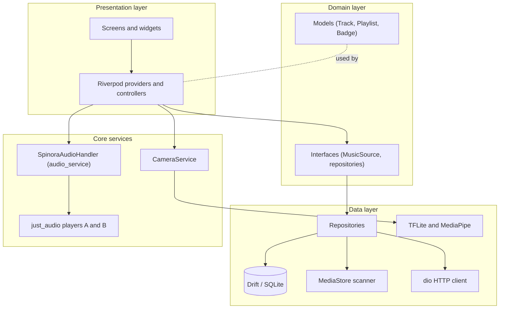

**Core rules**

1. UI never calls the database or network directly.
2. Every track, local or online, becomes one `Track` model. The player only knows `Track`.
3. Every online provider implements `MusicSource`.
4. The app reads the local database first; any sync runs in the background.
5. Heavy work (library scan, ML inference) runs in isolates, never on the UI thread.

## 6. Project Structure

```
spinora_app/
├── android/                    # Gradle (Kotlin DSL), flavors dev and prod
├── lib/
│   ├── main_dev.dart           # Entry point for the dev flavor
│   ├── main_prod.dart          # Entry point for the prod flavor
│   ├── app/                    # App widget, router, theme, flavor config
│   ├── core/
│   │   ├── audio/              # AudioHandler, crossfade, equalizer
│   │   ├── database/           # Drift tables, DAOs
│   │   ├── network/            # dio client, interceptors
│   │   └── utils/
│   ├── features/
│   │   ├── library/            # Local scan, songs, albums, artists
│   │   ├── player/             # Now Playing, queue, mini player
│   │   ├── online/             # MusicSource implementations (Audius)
│   │   ├── lyrics/
│   │   ├── equalizer/
│   │   ├── playlists/
│   │   ├── ai_mood/
│   │   ├── ai_gesture/
│   │   ├── achievements/
│   │   └── settings/
│   └── shared/                 # Glass widgets, buttons, loaders
├── assets/                     # Fonts, models (.tflite), badge rules (JSON)
├── test/
├── PROJECT_CONTEXT.md          # Rules and context for AI coding assistants
└── README.md
```

Each feature folder follows the same pattern:

```
features/<name>/
├── data/            # database access, API calls, platform channels
├── domain/          # models and interfaces
└── presentation/    # screens, widgets, providers
```

## 7. Domain Model

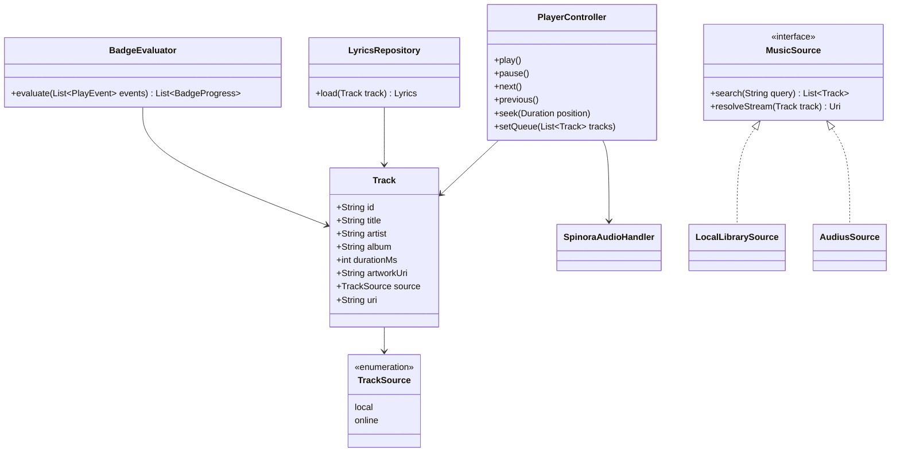

Core interface (Dart):

```dart
abstract class MusicSource {
  Future<List<Track>> search(String query);
  Future<Uri> resolveStream(Track track);
}
```

## 8. Database Design (ER Diagrams)

### 8.1 Local database (Drift / SQLite, on the phone)

This is the main database. The app works fully with only this.

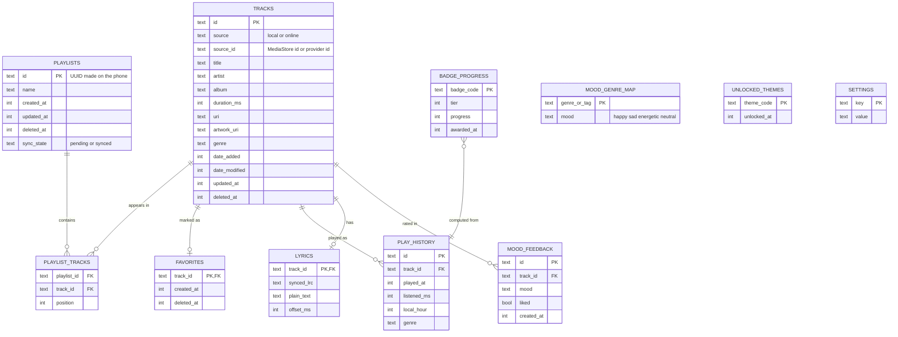

Notes:

- `updated_at`, `deleted_at` (soft delete), and `sync_state` exist from day one so optional sync can be added later without a painful migration.
- IDs for playlists are UUIDs generated on the phone, so they can be created offline.
- Music files are never stored in the database. Only metadata and file URIs.
- `PLAY_HISTORY` is append only. Badges are computed from it.

### 8.2 Optional server database (PostgreSQL, only if sync is built)

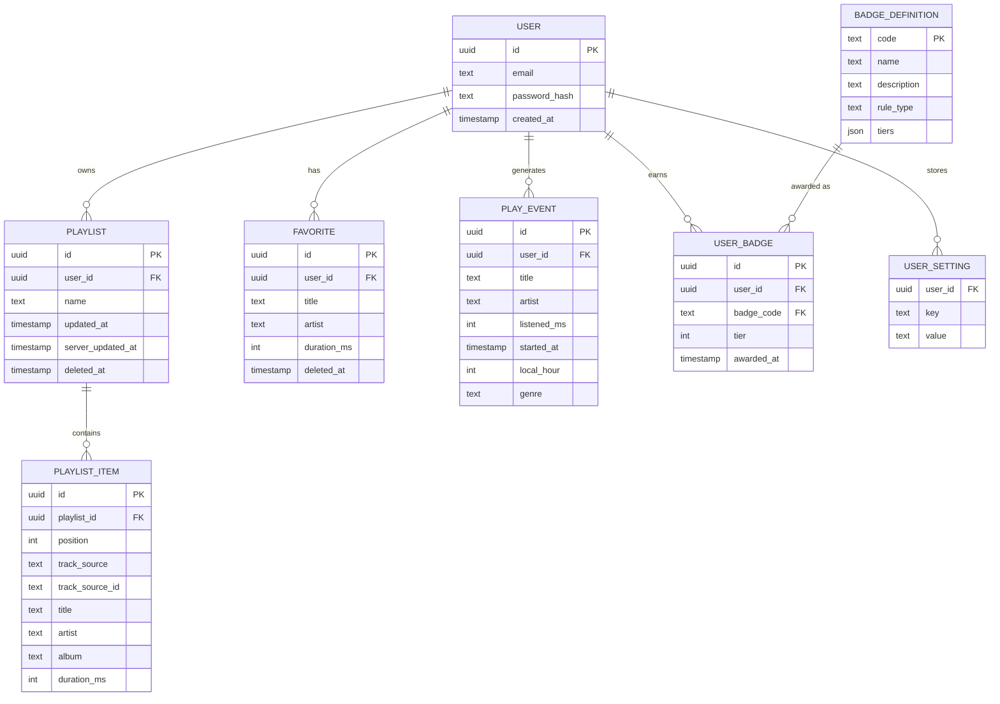

Only metadata is uploaded (title, artist, album, duration). Audio files stay on the phone.

## 9. Data Flow

### 9.1 System context

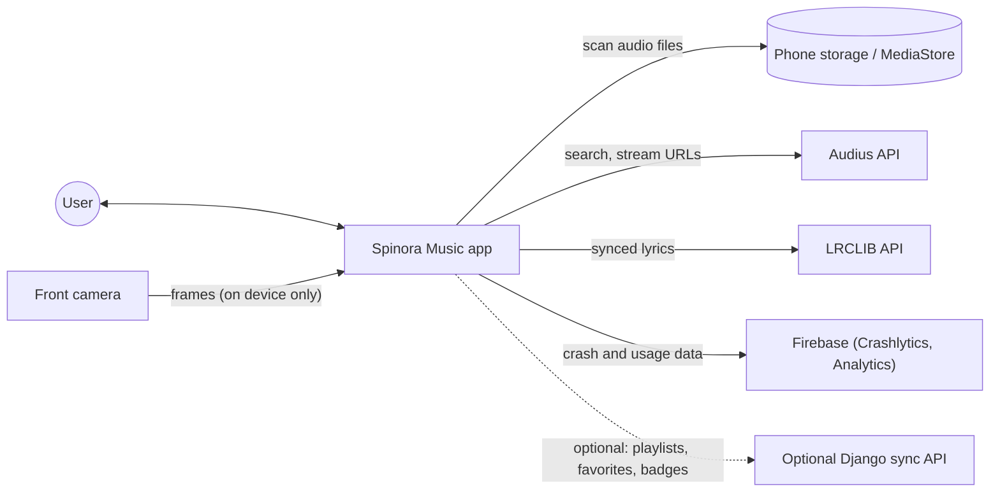

### 9.2 Internal data flow

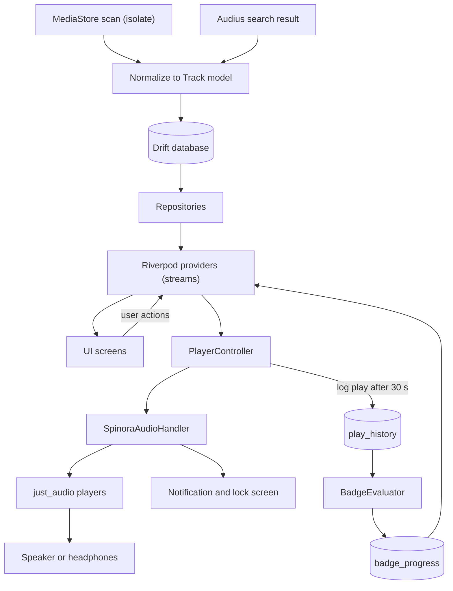

## 10. How Each Feature Works

### 10.1 First launch and library scan

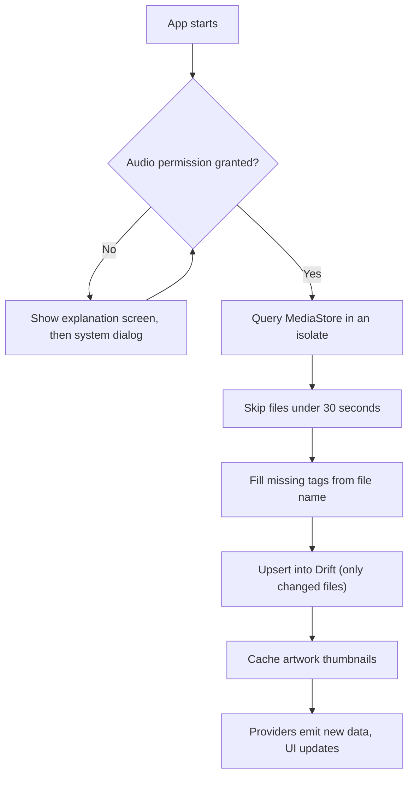

### 10.2 Playback

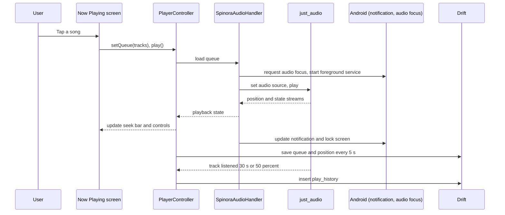

### 10.3 Online search and streaming

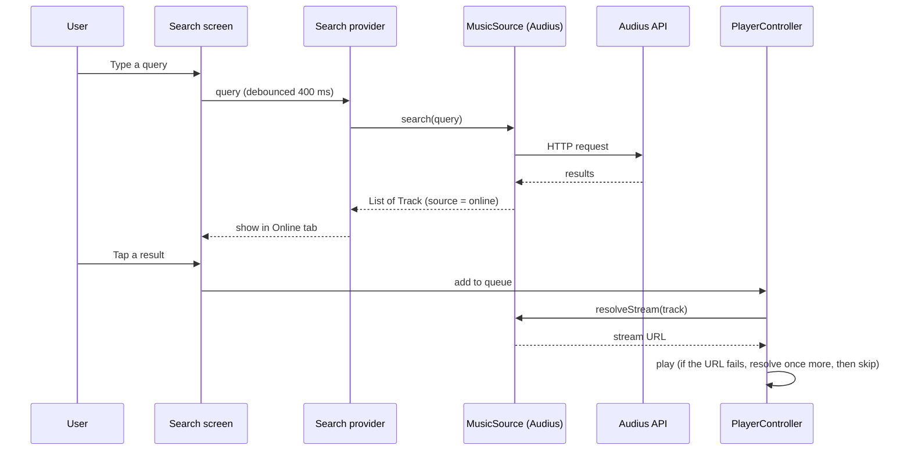

Offline behavior: online tracks are greyed out and skipped automatically. Data saver mode picks the lowest bitrate and disables prefetch on mobile data.

### 10.4 Synced lyrics

1. Look for lyrics in this order: embedded tags, a `.lrc` file next to the song, then the LRCLIB API (search by title, artist, album, duration).
2. Parse each `[mm:ss.xx] text` line into `LyricLine(timeMs, text)`.
3. Listen to the player position stream (about every 100 to 200 ms) and find the current line with a binary search.
4. Highlight the line, scroll smoothly, and let the user tap a line to seek.
5. Apply the saved per-song offset (plus or minus 2 seconds) and cache the result in the `lyrics` table.

### 10.5 Smart DJ crossfade

Two players, A (current) and B (next). When the remaining time of A equals the fade length:

```
fadeMs = user setting (default 5000)
when position >= duration - fadeMs and a next track exists:
  load next track into B, set B volume 0, start B
  every 50 ms for fadeMs:
    t = elapsed / fadeMs
    A.volume = cos(t * pi / 2)     // equal-power curve
    B.volume = sin(t * pi / 2)
  stop A, then swap roles of A and B
```

Edge cases handled: pause or seek during a fade, skip during a fade, tracks shorter than twice the fade (fade shortened), notification follows the active player, equalizer applied to both players.

### 10.6 Equalizer

The Android equalizer is attached to the player through an audio pipeline. The app reads the band count and gain range from the device, draws one slider per band, and saves presets (Flat, Bass Boost, Vocal, Rock, Pop, Jazz, Classical). A true 10-band engine with native audio processing is a later upgrade.

### 10.7 Dynamic theme from album art

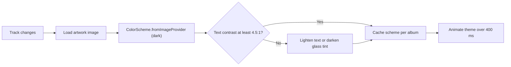

### 10.8 Mood detection

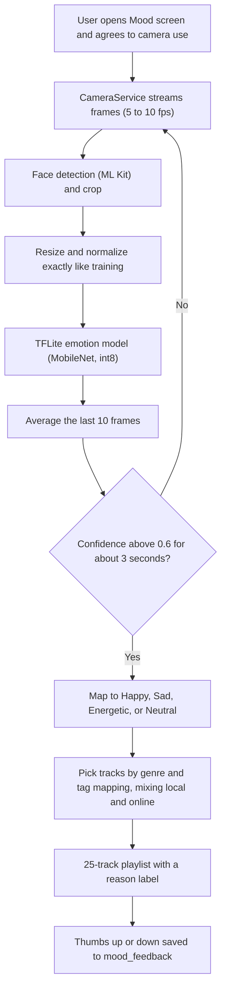

The camera result is a suggestion. The user can always pick a mood manually. Nothing from the camera is saved or uploaded.

### 10.9 Gesture control

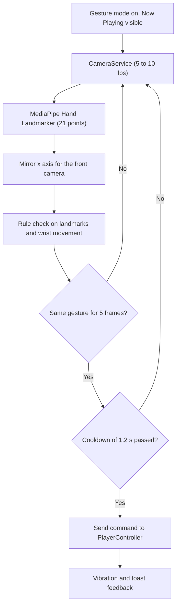

| Gesture | Rule | Action |
|---|---|---|
| Peace sign | Index and middle extended, ring and pinky folded | Play or pause |
| Swipe right | Open palm, wrist moves right over 25 percent of frame width in 400 ms | Next track |
| Swipe left | Same, moving left | Previous track |
| Thumbs up | Thumb extended, other fingers folded | Add to favorites |

Gesture mode turns off after 10 minutes of no gestures, when the battery is under 15 percent, and when battery saver is on. Mood detection and gesture mode never run together.

### 10.10 Achievements (local)

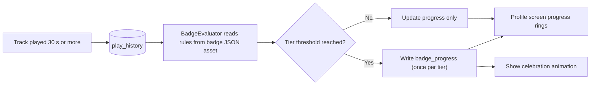

| Badge | Tiers | Rule |
|---|---|---|
| Night Owl | 1 h, 10 h, 50 h | Listening between midnight and 4 AM |
| Genre Explorer | 5, 10, 20 | Distinct genres with 3 or more plays |
| Galaxy Brain | 50, 200, 500 | Distinct artists played |
| Web Weaver | 1, 10, 25 | Playlists created |
| Streak Keeper | 7, 30, 100 days | Consecutive listening days |
| Mood Master | 5, 25, 100 | Mood playlists generated |
| Gesture Pro | 25, 100, 500 | Gesture commands used |

Anti-cheat: listened time is capped at the track length, overlapping events are ignored, and plays under 30 seconds do not count. Badge rules live in a JSON asset, so adding a badge needs no code change in the evaluator.

### 10.11 Secret themes

Themes are Flutter `ThemeExtension` objects with a palette and a web painter variant. They unlock through hidden actions (for example tapping the logo 7 times, or earning the Web Weaver badge). Unlocked themes are stored in `unlocked_themes`. All artwork is original.

### 10.12 Optional sync (built last)

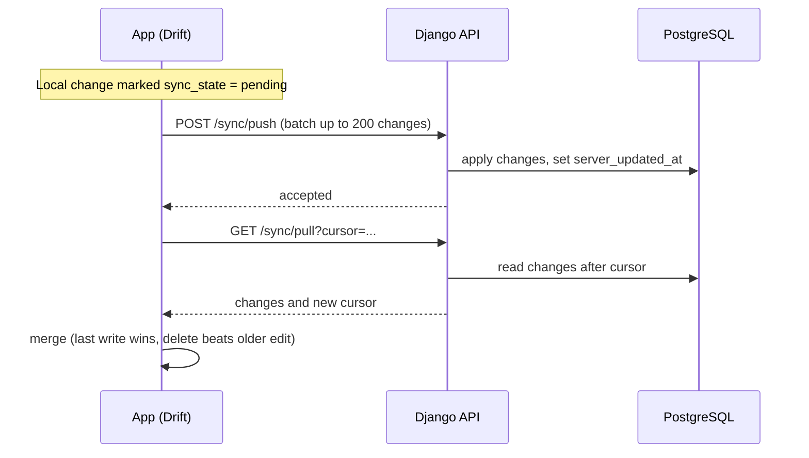

Pushing the same change twice is harmless (idempotent). Songs on other devices are matched by normalized title, artist, and duration within 2 seconds. Unmatched songs appear as "Not on this device".

## 11. Permissions

| Permission | Why |
|---|---|
| `READ_MEDIA_AUDIO` (Android 13 and above) | Scan local music |
| `READ_EXTERNAL_STORAGE` (Android 12 and below, max SDK 32) | Scan local music on older phones |
| `POST_NOTIFICATIONS` | Media notification on Android 13 and above |
| `FOREGROUND_SERVICE` and `FOREGROUND_SERVICE_MEDIA_PLAYBACK` | Background playback |
| `WAKE_LOCK` | Keep playback running with the screen off |
| `CAMERA` | Mood and gesture features only, foreground only |
| `INTERNET` | Online tracks, lyrics, crash reports |

Every permission is requested with a short explanation first, and denied states are handled (including "permanently denied" with a shortcut to settings).

## 12. Privacy and Security

- Camera frames are processed on the device and are never stored or uploaded.
- First use of a camera feature shows a consent dialog; each camera feature has its own toggle.
- Collected data is limited to crash reports and basic usage analytics (Firebase). If optional sync is added, only account email and music metadata are stored.
- No secrets in the repository: keystores, `key.properties`, `.env`, `google-services.json`, and API keys are listed in `.gitignore`.
- Tokens (if sync is added) are kept in `flutter_secure_storage`; traffic uses HTTPS only.
- An in-app Delete my account option is required if accounts are added.

## 13. Legal and Licensing Rules

- **Online music:** only sources whose terms allow it (Audius first). Check each provider's terms before any commercial use. Jamendo's free API is for non-commercial use.
- **No YouTube or YouTube Music stream extraction.** It conflicts with YouTube's terms and can get an app rejected or removed. A YouTube tab, if ever added, must use the official embedded player.
- **No Marvel, Spider-Man, or Venom names, logos, or art.** The web motif is an original shape.
- **Datasets:** confirm the license of every dataset and model for commercial use before release. Some research datasets are non-commercial only.
- **Hand tracking:** use MediaPipe (Apache 2.0). Avoid AGPL-licensed detectors in a closed-source app.
- **Open-source licenses:** keep a list of package licenses and show them in the app.
- This README is not legal advice. Have a lawyer review the terms before any commercial launch.

## 14. Getting Started

### Prerequisites

- Flutter SDK (stable) and Android Studio with an Android SDK
- A real Android phone with USB debugging (needed for camera, ML, and audio tests)
- Git
- Docker and Python 3.12 (only if you build the optional backend)

### Setup

```bash
git clone <your-repo-url>
cd spinora_app
flutter pub get
dart run build_runner build --delete-conflicting-outputs
flutter analyze
flutter test
```

### Run

```bash
flutter run --flavor dev -t lib/main_dev.dart
```

### Release build (when ready)

```bash
flutter build apk --release --flavor prod -t lib/main_prod.dart --obfuscate --split-debug-info=build/symbols
```

Keep the signing key outside the repository and back it up in two places.

## 15. Build Flavors

| Flavor | Entry point | Application ID | App name | Purpose |
|---|---|---|---|---|
| dev | `lib/main_dev.dart` | `com.spideytech.spinora.dev` | Spinora Dev | Daily development and testing |
| prod | `lib/main_prod.dart` | `com.spideytech.spinora` | Spinora | Releases |

The dev flavor uses its own database name and Firebase app, so test builds never touch real user data. The prod ID cannot change after the first Play Store upload.

## 16. Testing Strategy

| Level | Tools | Covers |
|---|---|---|
| Unit | flutter_test, mocktail | LRC parser, queue logic, crossfade math, gesture rules, mood mapping, badge rules |
| Widget | flutter_test | Mini player, queue screen, settings toggles |
| Integration | integration_test | Scan, play, background, playlists |
| Manual on real phones | Android 10 to latest | Audio focus, Bluetooth, camera, battery, notifications |
| Monitoring | Firebase Crashlytics | Crashes and ANRs |

Keep a test folder of about 50 audio files: normal MP3s, files without tags, Bangla and other Unicode names, a one-hour track, a corrupted file, very short files, and FLAC and M4A files. Every fixed bug gets a test.

## 17. Development Workflow

- **Branches:** `main` (always releasable), `develop`, `feature/<name>`.
- **Commits:** short, clear messages (for example `feat(player): add queue persistence`).
- **Every task:** has an ID (for example 2.8 Crossfade) and a Done when check. Tick it in the task tracker only when it is true.
- **AI-assisted development:** AI assistants write drafts of code and tests inside the editor, guided by `PROJECT_CONTEXT.md`. The developer reviews every change, runs it on a real phone, and handles accounts, Firebase, Docker, backend, git, and model training.
- **CI:** GitHub Actions runs `flutter analyze` and `flutter test` on every pull request.

## 18. Roadmap

| Phase | Weeks (full time) | Scope | Status |
|---|---|---|---|
| 0. Setup | 1 | Tools, repo, Flutter project, flavors, design system, CI | In progress |
| 1. Core and UI | 3 | Database, scanner, library, player, queue, glass UI, dynamic theme | Planned |
| 2. Streaming and audio | 3 | Audius source, unified queue, lyrics, equalizer, crossfade | Planned |
| 3. On-device AI | 4 | Camera service, mood model, gestures | Planned |
| 4. Gamification and optional sync | 3 | Local badges, secret themes, optional Django sync | Planned |
| 5. Friends release | 2 | QA, signed APK for friends; Play Store later if budget allows | Planned |

Total: about 16 weeks full time (double if part time).

**If time runs short, cut in this order:** optional backend and sync, secret themes, mood detection, gesture control, true 10-band equalizer.

**Later ideas:** iOS, true 10-band equalizer, Android widgets and Android Auto, offline downloads for licensed tracks, karaoke (needs paid compute), social sharing of badges.

## 19. Risks and Mitigations

| Risk | Mitigation |
|---|---|
| Store rejection from unlicensed music | Licensed sources only; `MusicSource` interface |
| Trademark complaints | Original art, theme, and badge names |
| Mood and gesture accuracy | Manual mood override, smoothing, test matrix |
| Battery drain from the camera | Low frame rate, foreground only, auto-off |
| Slow low-end phones | Few blur layers, Reduce effects setting |
| Plugin abandoned | Wrap each plugin behind an interface |
| Solo burnout or slipping schedule | Fixed scope per phase, cut list, weekly review |
| Lost signing key | Two backups of the upload key |

## 20. License

License to be decided. Until a license file is added, all rights are reserved by the author.

---

Built by SpideyTech.
